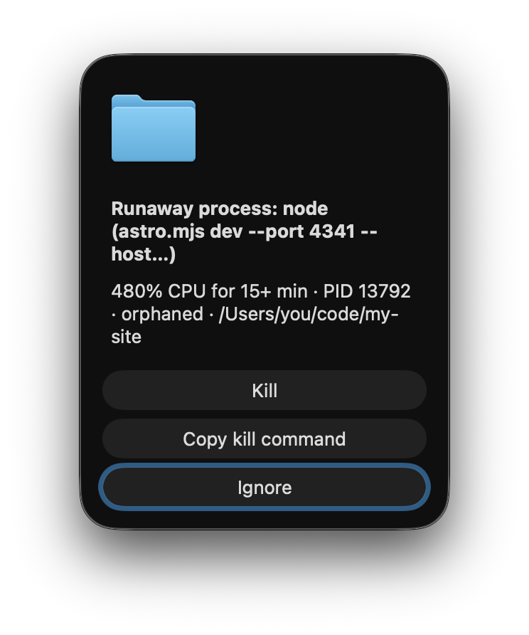

# cpu-watchdog

A macOS background agent that alerts you when a process has been pegging the
CPU, or when a dev server outlives the terminal, editor or AI agent that started it.



Every 5 minutes it flags:

- **Runaway processes**: averaging over 80% CPU for 15 minutes. This is the true
  average from cumulative CPU time, not a snapshot.
- **Forgotten dev servers**: `node`, `bun`, `deno`, `python`, `ruby`, `php` or
  `hugo` running a dev/serve/watch command (Vite, Astro, Next, uvicorn,
  runserver, `--reload`, …) with no parent process for 6+ hours.

Alerts:

- **Kill** stops the process *and its children*. It sends `SIGTERM`, then
  `SIGKILL` after 5 s if needed, and skips any PID that has exited or been reused.
- **Copy kill command** copies the equivalent shell command. Processes owned by
  root or other users get only this button, with `sudo`.
- **Ignore** is the default (Return/Esc), so an alert that steals focus mid-typing
  can't kill anything. If the problem persists, you're alerted again after 2 hours.
- Several problems at once share one alert. Alerts wait until you're at the
  keyboard, and an unanswered alert is left in Notification Center.

Each check costs about 0.1 s of CPU, using one `ps` call, in zsh with no dependencies.

## Install

```sh
git clone https://github.com/erickarnis/cpu-watchdog.git
cd cpu-watchdog
./install.sh              # ./install.sh uninstall to remove
```

The agent runs the script in place, so edits apply on the next check.

## Configure

Optional: create `~/.config/cpu-watchdog/config` (zsh syntax). Environment
variables override it.

```sh
CPU_THRESHOLD=150                 # % of one core; can exceed 100
STRIKES=3                         # consecutive 5-min checks before alerting
ORPHAN_HOURS=6
REALERT_HOURS=2                   # 0 = alert once per process
IDLE_MINUTES=2                    # hold alerts while you're away this long
IGNORE_RE='^(kernel_task|WindowServer|ffmpeg)$'   # process names never flagged for CPU
IGNORE_ARGS_RE='my-long-running-server'           # command lines never flagged
```

See the top of `cpu-watchdog.sh` for every setting. The log is at
`~/Library/Application Support/cpu-watchdog/watchdog.log`.

## Try it

`DRY_RUN=1` prints alerts instead of showing them:

```sh
yes > /dev/null &                 # fake CPU hog
export STATE_DIR=/tmp/wd-test INTERVAL=5 STRIKES=1 DRY_RUN=1
./cpu-watchdog.sh; sleep 5; ./cpu-watchdog.sh
kill %1
```

## License

MIT
